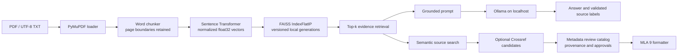

# LocalRAG

LocalRAG is an offline-first research assistant for searching a personal library of PDF and text documents. It combines semantic retrieval with locally generated, evidence-linked answers and a careful bibliographic review workflow. It is designed for an individual's local workstation, **not for public unauthenticated deployment**.

## What it does

- Loads PDF pages with PyMuPDF and UTF-8 TXT documents, skips blank text, and retains source and page metadata.
- Splits each page or text record into overlapping word chunks.
- Encodes batches with Sentence Transformers `all-MiniLM-L6-v2` (384 dimensions by default), normalizing vectors to unit length.
- Persists normalized vectors in FAISS `IndexFlatIP` generations and metadata in versioned JSON. The manifest switches to a new complete generation only after it is written.
- Retrieves semantically similar passages for local Ollama answers. Retrieved document content is untrusted evidence; valid source labels are checked, but label validity does not prove factual support.
- Searches for unique sources by topic and can optionally query Crossref. Bibliographic metadata keeps provenance, conflicts and reviewer approvals; MLA 9 output is limited to adequately verified or explicitly reviewed fields.
- Provides a local Streamlit dashboard for document upload/indexing, questions, citation search and metadata review.

## Architecture



The loader and chunker preserve the source and original PDF page index. Query and document vectors use the same configured embedding model. Since the vectors are normalized, FAISS inner product is cosine similarity. This score is neither a probability nor a measure of citation correctness. Bibliographic page ranges are separate from PDF page indices.

The index and documents are local. Citation approvals are stored separately from generated index files so index rebuilds do not erase the review history. Crossref access is opt-in; ordinary indexing, RAG and semantic retrieval do not require it.

## Windows setup (Python 3.12)

From the repository root in PowerShell:

```powershell
py -3.12 -m venv .venv
.venv\Scripts\python.exe -m pip install --upgrade pip
.venv\Scripts\python.exe -m pip install -e ".[dashboard,dev]"
```

The `dashboard` extra provides Streamlit, FAISS CPU and Sentence Transformers; PyMuPDF is a base dependency. To use the CLI RAG commands instead of the dashboard extra, install `.[rag,dev]`. Extras are intentionally separated so a loader-only installation need not install the larger ML stack. Installations of FAISS and PyTorch/Sentence Transformers can be platform-sensitive; use a supported 64-bit Python 3.12 environment and resolve any platform-specific wheel issue before proceeding.

### Local generation with Ollama

Install Ollama for Windows separately, then download the configured model:

```powershell
ollama pull llama3.2:3b
```

Keep Ollama listening on the local loopback interface. The dashboard validates configured Ollama URLs as loopback addresses. Do not expose Streamlit or Ollama to a public network without a deliberate security design, authentication and access controls. Local storage does not encrypt documents or indexes.

### Embedding model download and offline use

The first embedding/index operation may download the public `all-MiniLM-L6-v2` model from Hugging Face into the local model cache; an access token is not normally needed. Initial setup therefore requires network access. Later runs can use cached weights. The dashboard uses local-only loading and reports an error if the selected model is not cached. For an offline workstation, pre-cache the configured model before disconnecting. Model weights are not included in this repository.

## Run the dashboard

```powershell
.venv\Scripts\python.exe -m streamlit run streamlit_app.py
```

The app opens a local browser page. On **Documents**, upload PDF/TXT files and explicitly select **Rebuild Index**. Uploading a file does not trigger a full re-embedding on every rerun; queries use the persisted index. On **Ask AI**, enter a question and inspect the expandable passages, page indices and similarity scores. If Ollama is unavailable, the dashboard reports it; install/start Ollama and pull the selected model. On **Citation Search**, enter a topic. Crossref is disabled until explicitly enabled. On **Citation Review**, inspect field provenance/conflicts and provide a reviewer, verification source URL and explicit approval before saving a correction. Reviewer approval records a human decision; it is not an independent verification service.

Configuration presets are Fast Search, Balanced, Deep Research and Custom. They adjust retrieval depth and generation timeout. Advanced Settings retain local document/index/metadata paths, Ollama configuration, embedding model, chunking and upload limit. Settings persist in `data/dashboard-settings.json`.

## CLI use

Install `.[rag,dev]`, place local files under `data/documents`, then ingest once:

```powershell
.venv\Scripts\python.exe -m pip install -e ".[rag,dev]"
.venv\Scripts\python.exe -m localrag.cli ingest --documents data/documents --index data/index
```

Ask against the saved index:

```powershell
.venv\Scripts\python.exe -m localrag.cli "What does LocalRAG use FAISS for?" --documents data/documents --index data/index
```

Search for sources without generation:

```powershell
.venv\Scripts\python.exe -m localrag.cli search-citations "CPU management" --top-k 5
```

Add `--crossref` to permit optional online metadata lookup. Similarity filtering is optional; a universal threshold is not established by the included fixture evaluation. Review ambiguous records with `python -m localrag.cli citation-review --help` and the `list`, `show`, `approve`, and `mla` subcommands. Consult the source before approving corrections. Never treat PDF page indices as publication pagination.

## Tests

Install `.[dev]` for the offline test suite and run:

```powershell
.venv\Scripts\python.exe -m pytest
```

The standard suite uses fake models/clients and local fixtures. Optional real integrations are excluded unless explicitly enabled:

```powershell
$env:LOCALRAG_RUN_MODEL_INTEGRATION = "1"
.venv\Scripts\python.exe -m pytest tests/integration/test_embeddings_real.py
$env:LOCALRAG_RUN_OLLAMA_INTEGRATION = "1"
.venv\Scripts\python.exe -m pytest tests/integration/test_ollama_real.py
```

The real-corpus integration is also opt-in and reads the operator's ignored local index/documents. See `tests/integration/test_rag_corpus_real.py` for its environment flag. It is not appropriate for public CI.

## Evaluation

`evaluation/` contains three **synthetic, fictional** TXT documents, nine passage anchors, and 28 labeled questions (24 supported and 4 unsupported). These fixture labels are not external-paper judgments or human answer-quality reviews. To reproduce the retrieval-only benchmark, first install `.[rag,dev]` and run:

```powershell
.venv\Scripts\python.exe -m evaluation.run
```

The command measures the included corpus with `all-MiniLM-L6-v2`, FAISS `IndexFlatIP`, normalized float32 vectors, top 5 retrieval and two word-chunk configurations (200/40 and 400/80). It reports Recall@1/3/5, Precision@k and MRR over labeled answerable questions, plus timing, dimensions and vector counts. Precision divides by k even if fewer results are returned; MRR uses the first relevant passage. Ties are resolved by stable chunk ID. It writes run-specific files under ignored `evaluation/results/`; the tracked `evaluation/REPORT.md` is one recorded run, not a performance guarantee.

That recorded synthetic run reports:

| Chunk size / overlap | Chunks | Recall@1 | Recall@3 | Recall@5 | MRR |
|---|---:|---:|---:|---:|---:|
| 200 / 40 words | 6 | 0.6250 | 1.0000 | 1.0000 | 0.7986 |
| 400 / 80 words | 3 | 0.3333 | 0.8750 | 0.8750 | 0.5903 |

The report records mean query embedding latency of 0.0056–0.0060 s and mean FAISS latency of 0.0001 s on its recorded Python 3.12.10 environment; those small-corpus timings exclude process/import startup and model initialization, and should not be generalized to other hardware or corpora. Ollama generation was disabled in that run. Automated citation-label membership is not evidence that answer claims are factually grounded. Run `evaluation.run --with-generation` only with local Ollama available; output varies with model/runtime and must be manually reviewed. Small synthetic data does not establish general retrieval quality or a broadly valid similarity threshold.

## Privacy, rights and limitations

- Documents, the persisted FAISS index, settings, bibliography approvals, model files, caches and evaluation run output are local runtime data and ignored by Git. Local files are not encrypted by LocalRAG.
- Crossref is the only optional feature here that intentionally contacts an external metadata service; it is user-enabled and sends bibliographic search terms/DOIs. Do not include confidential query terms if this is a concern.
- FAISS index files are binary data and must only be loaded from trusted sources.
- PDF extraction is imperfect; scans may need OCR, and template titles or layout artifacts can survive screening. Bibliographic extraction is candidate generation, not proof. Crossref may be unavailable or ambiguous. MLA formatting is conservative and supports scholarly journal articles and proceedings only when necessary fields are verified or explicitly approved.
- Citation ID validation checks only that a returned label was present in the retrieved context. It does not establish entailment, factual accuracy or citation correctness. Ollama output can vary.
- Dense retrieval quality depends on the embedding model, chunk size, language, document quality, corpus and query. Large documents increase indexing time and storage. There is no built-in authentication or multi-user isolation; the application is intended for local use only.
- Only the included synthetic evaluation fixtures are supplied as benchmark content. No private research PDFs, downloaded model weights, local index or generated bibliography records should be committed. Check redistribution rights before adding third-party documents, screenshots or assets to a public release.

## Release preparation status

This repository is being prepared locally for review. No remote, GitHub publication or deployment is configured by this README. Review the working tree, licensing/provenance, current test results and screenshots before making any public release.

## License

Copyright (C) 2026 Guilherme Pupini for original LocalRAG project code, including AI-assisted project source files. This attribution does not claim ownership of third-party contributions, dependencies, model weights, or user documents. Original LocalRAG project code is licensed under the [GNU Affero General Public License v3 or later](LICENSE) (`AGPL-3.0-or-later`). Third-party software, model weights and user documents retain their own licenses and rights; see [THIRD_PARTY_NOTICES.md](THIRD_PARTY_NOTICES.md). PyMuPDF is dual-licensed under AGPL or a commercial license. The project does not redistribute PyMuPDF or model weights. Confirm that your use and distribution comply with the licenses of dependencies and models obtained separately.
